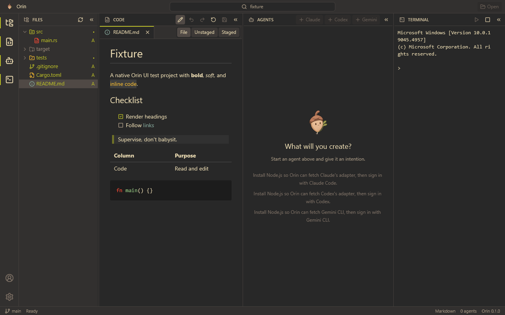
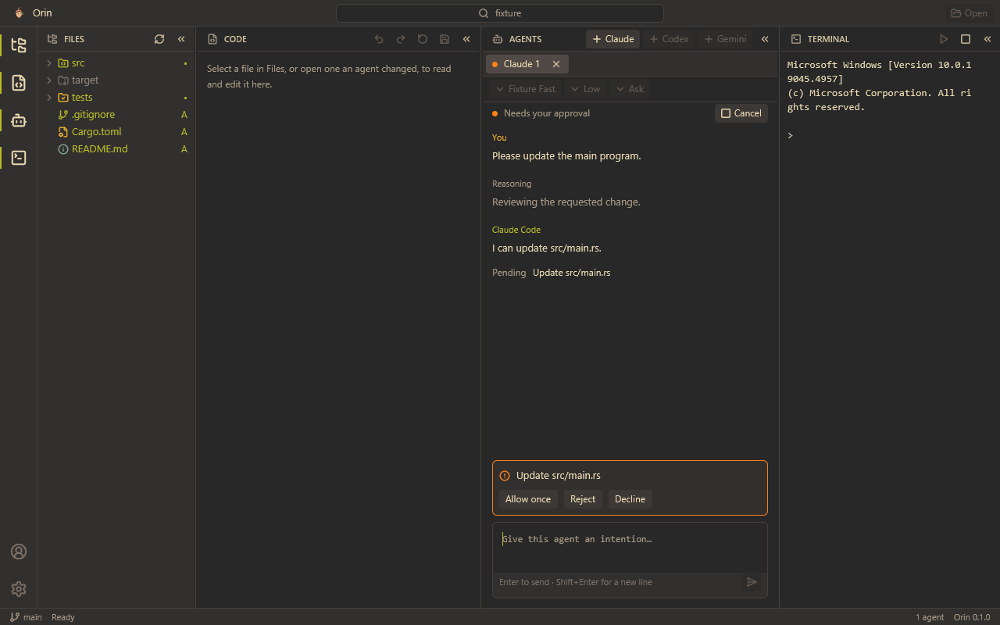
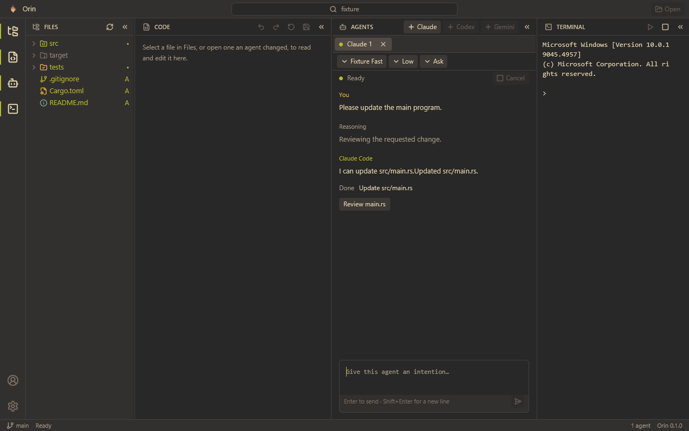
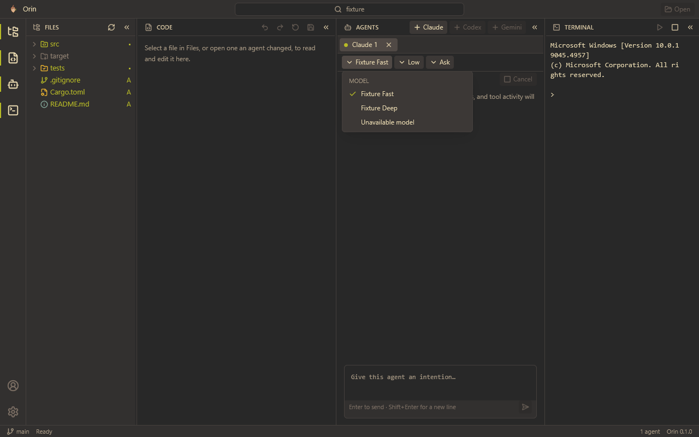
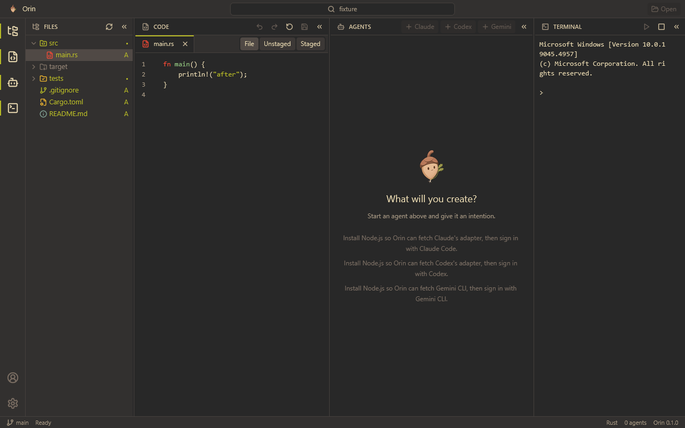
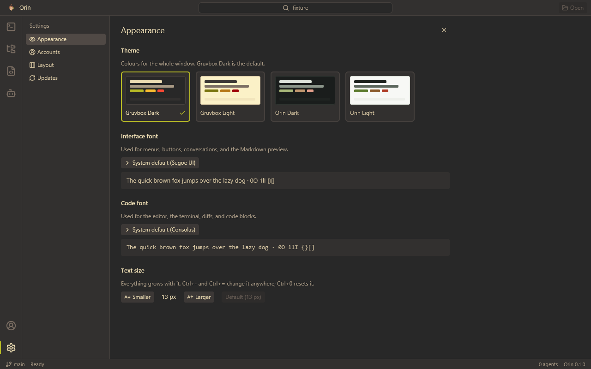
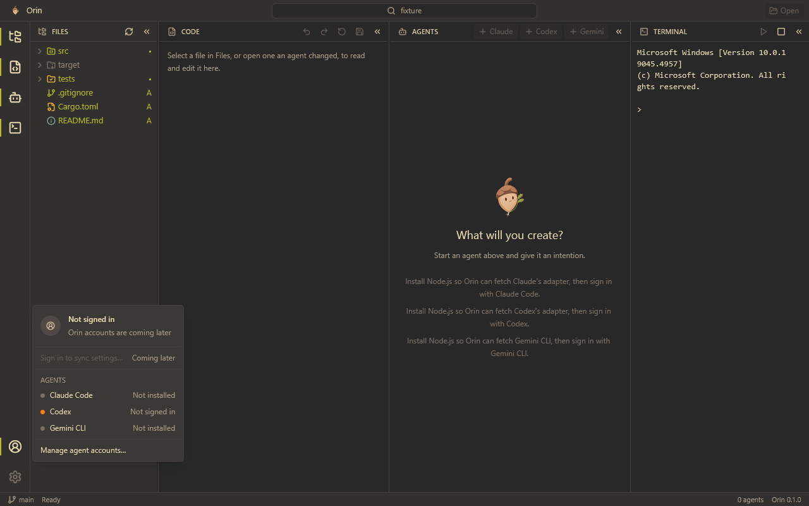

[//]: # ( ---------------------------------------------------------------------- )
[//]: # (+ Authors: 	Ran# <ran.hash@proton.me> )
[//]: # (+ Created: 	2026/11/11 12:19:33.694237 )
[//]: # (+ Revised: 	2026/11/13 08:56:38.755773 )
[//]: # ( ---------------------------------------------------------------------- )


<div align="center">


# Orin

**From intention to creation.**

An agent-first development environment by **Breren**, for developers who direct AI coding agents.

[](https://github.com/Ran-n/orin/releases/latest)

[](https://github.com/Ran-n/orin/releases)
[](https://gitlab.com/Ran-n/orin/-/releases)
[](https://codeberg.org/ran-n/orin/releases)
[](docs/vision.md)

[](https://github.com/Ran-n/orin/releases/latest)
[](#project-status)
[](docs/design-decisions.md)
[](docs/design-decisions.md)
[](LICENSE)

<picture>
  <source media="(prefers-color-scheme: light)" srcset="tests/rendered/baselines/windows/markdown-preview-light-1280.png" />
  
</picture>

[Why Orin?](#why-orin) · [A closer look](#a-closer-look) · [Getting started](#getting-started) · [Questions](#questions) · [Technical details](#technical-details)

</div>

## Project status

Orin is in **early development**. Version 0.1.0 is the first release: it opens projects, runs Claude Code, Codex,
and Gemini CLI side by side, shows each permission request for your answer, and lets you review and edit the results.
It has been verified on Windows; the Linux and macOS downloads are built but not yet verified on those systems.
Open questions are tracked in the [decision register](docs/design-decisions.md#implementation-status-of-open-areas).

## Why Orin?

Traditional IDEs put the code editor at the centre and add the AI agent on the side.
Orin is for developers who mostly direct agents, so it puts the agents at the centre instead.

- **Supervision first:** follow, compare, and review several agents' work at once.
- **Vendor-neutral:** run Claude Code, Codex, and Gemini CLI side by side in one workspace.
- **Uses your existing CLIs:** no Orin account, model, or subscription. It runs the agents you have already set up.
- **Native and light:** written in Rust with GPUI, built for fast startup and low resource use.
- **Edit when you need to:** review diffs and change files by hand without switching to another editor.

## A closer look

Everything is on screen at once, in four resizable columns:

| Column | Purpose |
| --- | --- |
| Files | Navigate the project's folders and files |
| Code | Read files, edit them by hand, preview Markdown, and inspect unstaged and staged changes |
| Agents | Hold conversations, delegate tasks, and supervise several coding agents; answer their permission requests |
| Terminal | Run commands in your own shell |

<table>
  <tr>
    <td width="50%"><br /><b>Answer permission requests</b><br />The agent waits until you allow or reject each change.</td>
    <td width="50%"><br /><b>Review what changed</b><br />Each changed file gets a Review button that opens it in Code.</td>
  </tr>
  <tr>
    <td width="50%"><br /><b>Pick the model</b><br />The agent's own model, effort, and mode lists, remembered per agent.</td>
    <td width="50%"><br /><b>Edit by hand</b><br />Code coloured by language, with its unstaged and staged changes.</td>
  </tr>
  <tr>
    <td width="50%"><picture><source media="(prefers-color-scheme: light)" srcset="tests/rendered/baselines/windows/settings-appearance-light-1280.png" /></picture><br /><b>Make it yours</b><br />Four themes, interface and code fonts, and text size.</td>
    <td width="50%"><br /><b>See your agent accounts</b><br />Each agent's sign-in, as its own CLI reports it.</td>
  </tr>
</table>

Drag a column's title to move it, drag the dividers to resize, and hide any column you don't need.
Settings (Ctrl+,) holds the theme (Gruvbox Dark by default, plus Gruvbox Light, Orin Dark, and Orin Light), interface and
code fonts, and text size; Orin remembers all of it.
It looks and works like VS Code where that helps: an activity bar, Git decorations in Files and the branch in the status
bar, a Welcome page with your recent folders, code coloured by language, the Markdown preview's look, a per-agent model
picker, and a terminal that is already running when the project opens.
Files refresh when they change on disk, and if a file you are editing changes underneath you, Orin keeps your edits and warns you.
See the [vision](docs/vision.md) for the full picture, including an example session.

## Download and install

Download the file for your system from the [latest release](https://github.com/Ran-n/orin/releases/latest)
(also on [GitLab](https://gitlab.com/Ran-n/orin/-/releases) and [Codeberg](https://codeberg.org/ran-n/orin/releases)).
Orin is a single portable program: there is nothing to install, so put it in a folder of your choice and open it.

| System | File |
| --- | --- |
| Windows (64-bit) | `orin-<version>-windows-x86_64.exe` |
| Linux (64-bit) | `orin-<version>-linux-x86_64` |
| macOS (Apple silicon) | `orin-<version>-macos-aarch64` |

Each file has a `.b3` checksum next to it. Orin checks for a new version once a day and updates itself from
**Settings › Updates**; you can turn that off there. Installers come later.

> [!NOTE]
> The downloads aren't signed yet. On Windows, SmartScreen may say it "protected your PC": choose **More info** › **Run anyway**.
> On Linux, make the file executable first (`chmod +x orin-*`). On macOS, run `chmod +x orin-*` and
> `xattr -d com.apple.quarantine orin-*` in Terminal before opening it.

## Getting started

1. [Download Orin](#download-and-install), or [run it from source](#run-from-source).
2. Install [Node.js](https://nodejs.org/) and sign in to the agents you use, such as Claude Code and Codex. Orin fetches
   their ACP adapters for you (see the [user guide](docs/user-guide.md#set-up-agents)).
3. On the Welcome page, choose **Open Folder…** or a recent folder.
4. Start an agent, pick its model, give it an intention, and answer its permission requests as they appear.
5. Review its changes in the **Code** column, edit by hand if needed, and run commands in the **Terminal** column.

The [user guide](docs/user-guide.md) covers every column, setting, and keyboard shortcut.

## Privacy and your data

- Orin works on local project folders and runs your agents' ACP adapters. It has no account and no telemetry. Its network use is `npx` fetching a missing adapter, and a daily update check against GitHub (GitLab if GitHub can't be reached), which you can turn off in **Settings › Updates**. Neither sends any personal data.
- What an agent sends to its vendor's service is governed by that agent and its vendor, not by Orin.
- When an agent asks permission to change files or run a command, nothing proceeds until you answer. Which actions ask first is set by each agent's own permission settings.
- Orin saves its window layout, appearance, open project, recent folders, each agent's chosen model, view choices, and update choices in a local settings file. It does not store your conversations or credentials.

## Questions

<details>
<summary>Which platforms will it support?</summary>

Windows, Linux, and macOS desktop. Web and mobile are out of scope.

</details>

<details>
<summary>Which coding agents will it support?</summary>

Claude Code, Codex, and Gemini CLI, through the [Agent Client Protocol](https://agentclientprotocol.com/) (ACP).
Orin fetches the ACP adapters for Claude Code and Codex with `npx` (Node.js needed); Gemini CLI supports ACP directly.
Each agent's own model list appears in a picker, so you can choose any model your plan includes.

</details>

<details>
<summary>Do I need an Orin account or API key?</summary>

No. Orin has no account of its own. It runs the agents you have already installed and signed in to.
The Accounts menu shows whether each agent is signed in, and Settings › Accounts can start its own login for you in the
terminal. An Orin sign-in (for syncing settings) appears in the menu as a placeholder; it may come later.
Each agent's own vendor terms and data handling still apply.

</details>

<details>
<summary>Does it replace my editor?</summary>

Orin includes an editor for the changes you make by hand while reviewing agents' work.
It is not meant to replace a full IDE's language tooling.

</details>

<details>
<summary>Is it free?</summary>

The [PayBack License (PBL) v2.0](LICENSE) permits free personal and non-commercial use.
Commercial use is subject to its revenue-sharing terms.

</details>

<details>
<summary>How do I report a problem or suggest a feature?</summary>

Open an issue on [GitHub](https://github.com/Ran-n/orin/issues), [GitLab](https://gitlab.com/Ran-n/orin/-/issues),
or [Codeberg](https://codeberg.org/ran-n/orin/issues), following [Reporting Bugs](CONTRIBUTING.md#reporting-bugs)
or [Suggesting Features](CONTRIBUTING.md#suggesting-features).

</details>

## Run from source

You need [Git](https://git-scm.com/) and [Rust](https://www.rust-lang.org/tools/install) (the repository pins the exact toolchain).
Linux also needs the native libraries listed in the [development guide](docs/development.md#prerequisites).

```sh
git clone git@github.com:Ran-n/orin.git
cd orin
cargo run --release
```

To open a project directly, run `cargo run --release -- --project PATH`.
Mirror URLs, tests, and the full build guide are in the [development guide](docs/development.md).

Run `cargo test --all-features` for the test suite and `cargo coverage` for the domain coverage gate
(requires `cargo-llvm-cov`; setup is in the development guide).

## Technical details

| Document | Contents |
| --- | --- |
| [Product vision](docs/vision.md) | Problem, differentiators, scope, philosophy, and etymology |
| [User guide](docs/user-guide.md) | Agent set-up, the workspace, settings, shortcuts, command-line options, and your data |
| [Development guide](docs/development.md) | Prerequisites, build and run, tests, repository layout, engineering standards, and releases |
| [Design decisions](docs/design-decisions.md) | Architecture decision records and open decisions |
| [Contributing](CONTRIBUTING.md) | Bug reports, feature proposals, changes, and commit style |
| [Changelog](CHANGELOG.md) | Change history |
| [Contributors](CONTRIBUTORS) | Authoritative ownership and revenue-share record |

**Built with:** Rust and [GPUI](https://gpui.rs/). Icons from [Lucide](https://lucide.dev/) (ISC license, see [assets/icons/LICENSE](assets/icons/LICENSE)).
The default colours are the [Gruvbox](https://github.com/morhetz/gruvbox) palette by Pavel Pertsev (MIT license).

## License

[PayBack License (PBL) v2.0](LICENSE).
Personal and non-commercial use is free; commercial use is subject to the license's revenue-sharing terms.
